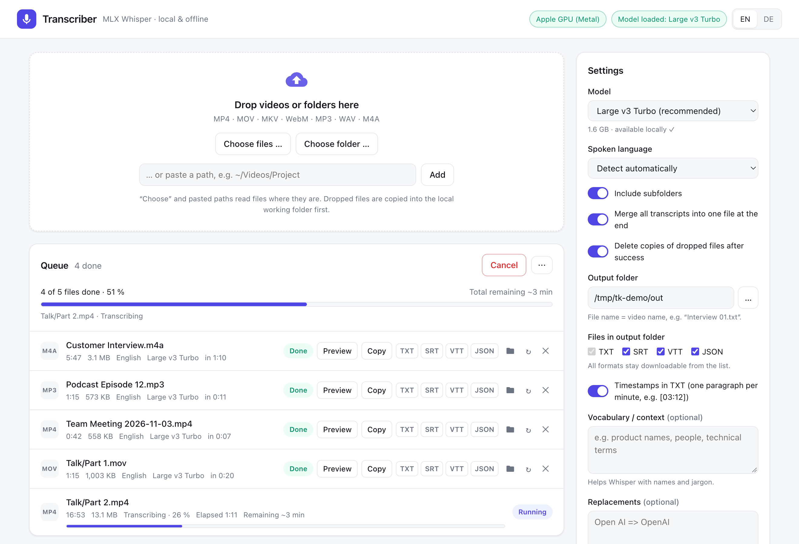
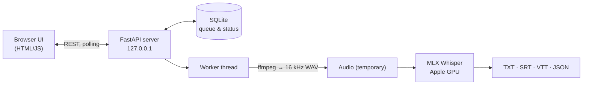

<div align="center">

# 🎙️ MLX Batch Transcriber

**Transcribe entire video collections with one click – locally, offline and free on your Mac.**

Whisper Large v3 Turbo on the Apple GPU, a lean web UI with drag & drop
and a queue that survives restarts.




</div>

---

## Contents

- [Why?](#why)
- [Features](#features)
- [Quick start](#quick-start)
- [Set up with Cursor](#set-up-with-cursor)
- [Usage](#usage)
- [Output](#output)
- [Models & speed](#models--speed)
- [Privacy & offline use](#privacy--offline-use)
- [How it works](#how-it-works)
- [Self test](#self-test)
- [Troubleshooting](#troubleshooting)

## Why?

Training videos, interviews, meetings, podcasts – hours of material you want to search, quote or summarize.
Cloud services charge per minute and your data leaves the building. This tool uses your Mac's GPU instead,
via Apple's [MLX](https://github.com/ml-explore/mlx) framework:

- **Fast:** about **20× real time** – 4 hours of video in roughly 12 minutes (measured on an M5 with 24 GB).
- **Private:** audio and text stay on your machine. No cloud, no account, no API keys.
- **Simple:** pick a folder, click *Start*, done.

## Features

| | |
|---|---|
| 📂 **Files & folders** | Drag & drop multiple files, native file/folder dialog or paste a path – optionally including subfolders |
| 🎞️ **Formats** | MP4, MOV, MKV, WebM, MP3, WAV, M4A |
| 🌍 **Language** | Automatic detection or manual choice from ~100 languages |
| 🧠 **Models** | Large v3 Turbo (default), Large v3, Medium, Small, Base, Tiny |
| 📊 **Progress** | Per file and for the whole queue, including elapsed time and ETA |
| 📝 **Export** | TXT (optionally with minute timestamps), SRT, VTT, JSON with timestamps |
| 📚 **Merge** | All transcripts in one file, with file names as headings |
| ⏯️ **Control** | Cancel, resume, retry failed files, re-transcribe single files |
| ♻️ **Smart** | Files that are already transcribed are skipped |
| 💾 **Persistent** | Queue and status live in SQLite – a restart never loses progress |
| 👀 **Preview** | Read transcripts in the browser (with or without timestamps) and copy them with one click |
| 🧹 **Quality** | Filters typical Whisper hallucinations during silence, replacement rules for domain terms |
| 🌐 **Bilingual UI** | English (default) and German – switch with **EN / DE** in the top bar |

<div align="center">

</div>

## Quick start

**Requirements:** Mac with Apple Silicon (M1 or newer), macOS 14+, about 5 GB of free disk space
(Python environment + model). Homebrew, FFmpeg or a specific Python version are **not** required –
the setup brings everything it needs.

```bash
git clone https://github.com/joe23byte/mlx-batch-transcriber.git
cd mlx-batch-transcriber
./setup.sh      # one-time: Python 3.12, dependencies, FFmpeg, model (~1.6 GB), self test
./start.sh      # starts the app and opens http://127.0.0.1:8765 in your browser
```

Or simply double-click **`Start Transcriber.command`** in Finder.

> [!TIP]
> On the very first run `./start.sh` runs the setup automatically, so a single command is enough.

If needed, `setup.sh` installs [uv](https://docs.astral.sh/uv/), which creates a dedicated Python 3.12
environment in `.venv/` – your system Python stays untouched.

| Command | Effect |
|---|---|
| `./setup.sh` | Full setup incl. model download and self test |
| `./setup.sh --skip-test` | Setup without self test |
| `./setup.sh --no-model` | Download the model on the first transcription instead |
| `./start.sh --port 9000` | Use a different port |
| `./start.sh --no-browser` | Don't open the browser automatically |

## Set up with Cursor

1. In Cursor choose **Clone Repository** and enter `https://github.com/joe23byte/mlx-batch-transcriber`.
2. Open the agent chat and type:

   ```text
   Set up this project and start it: run ./setup.sh and then ./start.sh.
   ```

The agent finds everything it needs about setup, architecture and tests in [`AGENTS.md`](AGENTS.md).

## Usage

1. **Add files**
   - **"Choose files …" / "Choose folder …"** open the macOS dialog. Files are read in place – ideal for
     large videos.
   - **Drag & drop** onto the drop zone: the browser first copies the files into a local working folder
     (`data/uploads/`). The copy is deleted automatically after a successful transcription.
   - **Paste a path**, e.g. `~/Videos/Training`.
2. **Check the settings** (right column) – model, language, output folder, formats.
3. Click **Start**. Files are processed one after another; the model is loaded only once.
4. **Open the results:** *Preview*, *Copy*, downloads (TXT · SRT · VTT · JSON) or 📁 to reveal in Finder.

The interface language can be switched at any time with **EN / DE** in the top bar; the choice is remembered
in the browser.

**Tips for better results**

- **Vocabulary / context:** enter names and technical terms (e.g. `Kubernetes, Jira, Dr. Miller`).
  Whisper mainly takes them into account at the beginning of each file.
- **Replacements:** for stubborn errors add one rule per line, e.g. `Open AI => OpenAI`. Rules match whole
  words and ignore case.
- **↻ Re-transcribe:** applies changed settings to a finished file.

## Output

For every file the output folder (default: `transcripts/`) gets a file with **the name of the video** –
`Interview 01.mp4` → `Interview 01.txt`. Subfolders are preserved.

With **timestamps** enabled, the TXT is split into one paragraph per minute:

```text
[00:00] Welcome to our podcast. Today we talk about how to turn long video recordings into
searchable text quickly and completely offline. …

[01:02] In the second part we look at the available models and how timestamps help you
navigate long recordings. …
```

| Format | Content |
|---|---|
| **TXT** | Plain text, optionally with an `[mm:ss]` marker per minute – always written |
| **SRT** | Subtitles for video players and editing software |
| **VTT** | Subtitles for the web (HTML5 `<track>`) |
| **JSON** | Full text, segments with start/end, language, model, processing time |

The settings control which formats are written to the output folder. All formats can always be downloaded
from the UI. With **Merge** enabled, all transcripts are additionally combined into `All_Transcripts.txt`.

## Models & speed

| Model | Size | Use case |
|---|---|---|
| **Large v3 Turbo** *(default)* | 1.6 GB | Best balance of quality and speed |
| Large v3 | 3.1 GB | Maximum accuracy, about half as fast |
| Medium | 1.5 GB | Previous generation, solid |
| Small / Base / Tiny | 480 / 150 / 75 MB | Very fast, for drafts or older Macs |

Models come from [mlx-community](https://huggingface.co/mlx-community) and are downloaded once into the
Hugging Face cache (`~/.cache/huggingface`) on first use.

**Measurements** (Apple M5, 24 GB RAM, Large v3 Turbo, German training videos):

| Material | Duration | Processing |
|---|---|---|
| 14 videos, 6.3 GB | 4 h 12 min | ≈ 12 min (≈ 21× real time) |
| Single video | 29 min | ≈ 60 s |

## Privacy & offline use

- No external APIs, no telemetry, no running costs.
- The server listens on `127.0.0.1` only and is not reachable from other machines.
- Internet is needed only for the setup and the **one-time** model download. After that everything works
  offline – models are loaded strictly from the local cache.

## How it works



- **One worker, one model:** a single background thread loads the model exactly once and processes the files
  sequentially – this keeps memory usage low.
- **Audio extraction:** FFmpeg converts every file to 16 kHz mono WAV; the temporary file is deleted right
  after it has been read. FFmpeg ships as a static arm64 binary via
  [`imageio-ffmpeg`](https://github.com/imageio/imageio-ffmpeg) (an existing system FFmpeg takes precedence).
- **Progress & cancellation:** the progress bar of `mlx_whisper` is intercepted; it drives both the progress
  display and instant cancellation.
- **Robustness:** `condition_on_previous_text` is disabled to avoid hallucination cascades after silence;
  well-known phantom phrases (e.g. "Thanks for watching", TV subtitle credits) are filtered out.
- **Persistence:** every status change is written to SQLite (`data/state.db`) immediately. On startup,
  interrupted files are put back into the queue.
- **Translations:** all UI texts live in [`app/static/i18n.js`](app/static/i18n.js). The server only returns
  language-neutral error keys (e.g. `error.corrupt`), which the browser translates.

<details>
<summary><b>Project structure</b></summary>

```text
.
├── setup.sh                     # One-time setup
├── start.sh                     # Start (runs the setup if needed)
├── Start Transcriber.command    # Double-click launcher for Finder
├── selftest.py                  # End-to-end self test
├── requirements.txt
├── app/
│   ├── __main__.py              # Launcher: port, browser, detects a running instance
│   ├── server.py                # FastAPI endpoints
│   ├── engine.py                # Worker, model, progress, ETA
│   ├── jobs.py                  # Queueing files, skipping, uploads
│   ├── media.py                 # FFmpeg: duration, audio extraction
│   ├── exporters.py             # TXT/SRT/VTT/JSON, filters, replacements
│   ├── db.py                    # SQLite (thread-safe)
│   ├── config.py                # Paths, models, default settings
│   └── static/                  # UI (HTML, CSS, JS, translations – no build step)
└── data/                        # Runtime data, not in git
```

</details>

## Self test

```bash
.venv/bin/python selftest.py
```

The test generates its own media with macOS text-to-speech, starts an isolated server in a temporary
directory and checks about 50 things – including language detection, all export formats, skipping,
cancel/resume, broken files, uploads, merging, complete EN/DE translations and recovery after a hard restart
in the middle of processing. Your real working state is not touched.

## Troubleshooting

<details>
<summary><b>"MLX requires a Mac with Apple Silicon"</b></summary>

MLX only runs on M-series chips. Intel Macs are not supported.
</details>

<details>
<summary><b>The folder dialog doesn't appear</b></summary>

It sometimes opens behind the browser window – switch with <kbd>⌘</kbd> + <kbd>Tab</kbd>.
Alternatively paste the path into the input field or drag & drop the files.
</details>

<details>
<summary><b>Port 8765 is in use</b></summary>

`start.sh` automatically falls back to the next free port. If the app is already running, starting it again
just opens the browser.
</details>

<details>
<summary><b>Strange sentences in silent passages</b></summary>

Whisper sometimes "invents" text during long pauses. The most common phrases are filtered. Remaining errors
can be fixed with **Replacements**, or re-transcribe with ↻ using a different model.
</details>

<details>
<summary><b>Reset the working state</b></summary>

Quit the app and delete the `data/` folder. Transcripts in the output folder are kept.
</details>

---

<div align="center">
<sub>Built with <a href="https://github.com/ml-explore/mlx-examples/tree/main/whisper">MLX Whisper</a>,
<a href="https://fastapi.tiangolo.com">FastAPI</a> and
<a href="https://ffmpeg.org">FFmpeg</a>.</sub>
</div>
