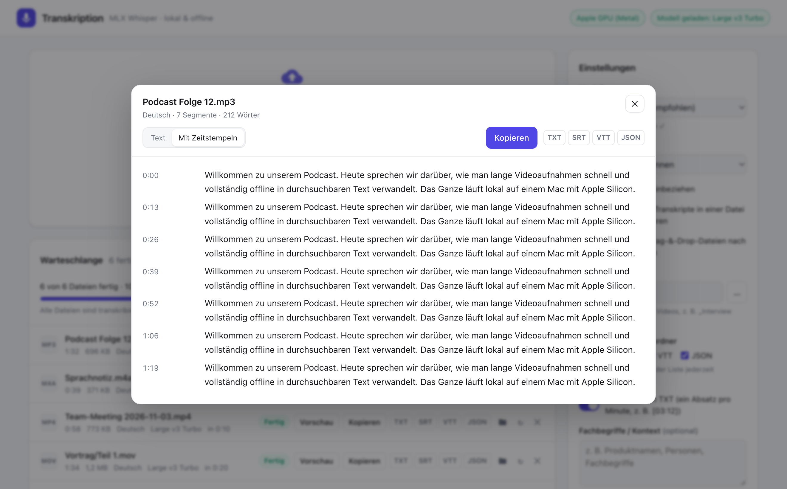
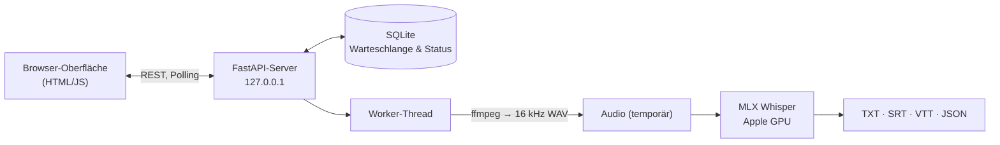

<div align="center">

# 🎙️ MLX Batch Transcriber

**Ganze Videosammlungen per Knopfdruck transkribieren – lokal, offline und kostenlos auf deinem Mac.**

Whisper Large v3 Turbo auf der Apple-GPU, eine schlanke Weboberfläche mit Drag & Drop
und eine Warteschlange, die auch einen Neustart übersteht.


</div>

---

## Inhalt

- [Warum?](#warum)
- [Funktionen](#funktionen)
- [Schnellstart](#schnellstart)
- [Mit Cursor einrichten](#mit-cursor-einrichten)
- [Bedienung](#bedienung)
- [Ausgabe](#ausgabe)
- [Modelle & Geschwindigkeit](#modelle--geschwindigkeit)
- [Datenschutz & Offline-Betrieb](#datenschutz--offline-betrieb)
- [Wie es funktioniert](#wie-es-funktioniert)
- [Funktionstest](#funktionstest)
- [Fehlerbehebung](#fehlerbehebung)

## Warum?

Schulungsvideos, Interviews, Meetings, Podcasts – oft liegen Stunden an Material herum, das man durchsuchen,
zitieren oder zusammenfassen möchte. Cloud-Dienste kosten pro Minute und die Daten verlassen das Haus.
Dieses Tool nutzt stattdessen die GPU deines Macs über Apples [MLX](https://github.com/ml-explore/mlx)-Framework:

- **Schnell:** rund **20× Echtzeit** – 4 Stunden Video in etwa 12 Minuten (gemessen auf einem M5 mit 24 GB).
- **Privat:** Audio und Text bleiben auf deinem Rechner. Keine Cloud, kein Konto, keine API-Keys.
- **Bequem:** Ordner auswählen, auf *Starten* klicken, fertig.

## Funktionen

| | |
|---|---|
| 📂 **Dateien & Ordner** | Drag & Drop mehrerer Dateien, nativer Datei-/Ordnerdialog oder Pfad einfügen – optional inkl. Unterordnern |
| 🎞️ **Formate** | MP4, MOV, MKV, WebM, MP3, WAV, M4A |
| 🌍 **Sprache** | Automatische Erkennung oder manuelle Auswahl aus ~100 Sprachen |
| 🧠 **Modelle** | Large v3 Turbo (Standard), Large v3, Medium, Small, Base, Tiny |
| 📊 **Fortschritt** | Pro Datei und für die ganze Warteschlange, inkl. Laufzeit und geschätzter Restzeit |
| 📝 **Export** | TXT (optional mit Minuten-Zeitmarken), SRT, VTT, JSON mit Zeitstempeln |
| 📚 **Zusammenführen** | Alle Transkripte in einer Datei, Dateinamen als Überschriften |
| ⏯️ **Steuerung** | Abbrechen, Fortsetzen, fehlgeschlagene wiederholen, einzelne Dateien neu transkribieren |
| ♻️ **Intelligent** | Bereits transkribierte Dateien werden übersprungen |
| 💾 **Persistent** | Warteschlange und Status liegen in SQLite – ein Neustart vernichtet keinen Fortschritt |
| 👀 **Vorschau** | Transkript im Browser lesen (mit/ohne Zeitstempel) und mit einem Klick kopieren |
| 🧹 **Qualität** | Filter gegen typische Whisper-Halluzinationen in Stillephasen, Ersetzungsregeln für Fachbegriffe |

<div align="center">

</div>

## Schnellstart

**Voraussetzungen:** Mac mit Apple Silicon (M1 oder neuer), macOS 14+, ca. 5 GB freier Speicher
(Python-Umgebung + Modell). Homebrew, FFmpeg oder eine passende Python-Version sind **nicht** nötig –
das Setup bringt alles mit.

```bash
git clone https://github.com/joe23byte/mlx-batch-transcriber.git
cd mlx-batch-transcriber
./setup.sh      # einmalig: Python 3.12, Abhängigkeiten, FFmpeg, Modell (~1,6 GB), Funktionstest
./start.sh      # startet die App und öffnet http://127.0.0.1:8765 im Browser
```

Alternativ im Finder einfach **`Transkription starten.command`** doppelklicken.

> [!TIP]
> `./start.sh` führt beim allerersten Aufruf das Setup automatisch aus. Ein einziger Befehl genügt also.

`setup.sh` installiert bei Bedarf [uv](https://docs.astral.sh/uv/), das eine eigene Python-3.12-Umgebung in
`.venv/` anlegt – dein System-Python bleibt unberührt.

| Befehl | Wirkung |
|---|---|
| `./setup.sh` | Komplettes Setup inkl. Modell-Download und Funktionstest |
| `./setup.sh --skip-test` | Setup ohne Funktionstest |
| `./setup.sh --no-model` | Modell erst bei der ersten Transkription laden |
| `./start.sh --port 9000` | Anderen Port verwenden |
| `./start.sh --no-browser` | Browser nicht automatisch öffnen |

## Mit Cursor einrichten

1. In Cursor **Clone Repository** wählen und `https://github.com/joe23byte/mlx-batch-transcriber` eingeben.
2. Den Agent-Chat öffnen und eingeben:

   ```text
   Richte dieses Projekt ein und starte es: führe ./setup.sh aus und danach ./start.sh.
   ```

Der Agent findet in [`AGENTS.md`](AGENTS.md) alle nötigen Infos zu Setup, Architektur und Tests.

## Bedienung

1. **Dateien hinzufügen**
   - **„Dateien wählen …“ / „Ordner wählen …“** öffnen den macOS-Dialog. Die Dateien werden direkt am
     Speicherort gelesen – ideal für große Videos.
   - **Drag & Drop** auf die Fläche: Der Browser kopiert die Dateien zuerst in einen lokalen Arbeitsordner
     (`data/uploads/`). Nach erfolgreicher Transkription wird die Kopie automatisch gelöscht.
   - **Pfad einfügen**, z. B. `~/Videos/Schulung`.
2. **Einstellungen prüfen** (rechte Spalte) – Modell, Sprache, Ausgabeordner, Formate.
3. **Starten** klicken. Dateien werden nacheinander verarbeitet; das Modell wird nur einmal geladen.
4. **Ergebnisse** öffnen: *Vorschau*, *Kopieren*, Downloads (TXT · SRT · VTT · JSON) oder 📁 im Finder zeigen.

**Tipps für bessere Ergebnisse**

- **Fachbegriffe / Kontext:** Namen und Fachwörter eintragen (z. B. `Kubernetes, Jira, Frau Dr. Meier`).
  Whisper berücksichtigt sie vor allem am Anfang jeder Datei.
- **Ersetzungen:** Für hartnäckige Fehler eine Regel pro Zeile, z. B. `Open AI => OpenAI`. Gilt für ganze
  Wörter, unabhängig von Groß-/Kleinschreibung.
- **↻ Neu transkribieren:** Wendet geänderte Einstellungen auf eine fertige Datei an.

## Ausgabe

Für jede Datei entsteht im Ausgabeordner (Standard: `transkripte/`) eine Datei mit **dem Namen des
Videos** – `Interview 01.mp4` → `Interview 01.txt`. Unterordner bleiben erhalten.

Mit aktivierten **Zeitmarken** gliedert sich das TXT in einen Absatz pro Minute:

```text
[00:00] Herzlich willkommen zu unserem Podcast. Heute sprechen wir darüber, wie man lange
Videoaufnahmen schnell und vollständig offline in durchsuchbaren Text verwandelt. …

[01:02] Im zweiten Teil schauen wir uns an, welche Modelle es gibt und wie man mit Zeitstempeln
gezielt in langen Aufnahmen navigiert. …
```

| Format | Inhalt |
|---|---|
| **TXT** | Fließtext, optional mit `[mm:ss]`-Marke pro Minute – immer erzeugt |
| **SRT** | Untertitel für Videoplayer und Schnittprogramme |
| **VTT** | Untertitel fürs Web (HTML5 `<track>`) |
| **JSON** | Volltext, Segmente mit Start/Ende, Sprache, Modell, Verarbeitungsdauer |

In den Einstellungen lässt sich festlegen, welche Formate im Ausgabeordner landen. Alle Formate bleiben in der
Oberfläche jederzeit herunterladbar.

## Modelle & Geschwindigkeit

| Modell | Größe | Einsatz |
|---|---|---|
| **Large v3 Turbo** *(Standard)* | 1,6 GB | Beste Balance aus Qualität und Tempo |
| Large v3 | 3,1 GB | Maximale Genauigkeit, etwa halb so schnell |
| Medium | 1,5 GB | Ältere Generation, solide |
| Small / Base / Tiny | 480 / 150 / 75 MB | Sehr schnell, für Entwürfe oder schwache Macs |

Modelle stammen von [mlx-community](https://huggingface.co/mlx-community) und werden beim ersten Gebrauch
einmalig in den Hugging-Face-Cache (`~/.cache/huggingface`) geladen.

**Messwerte** (Apple M5, 24 GB RAM, Large v3 Turbo, deutsche Schulungsvideos):

| Material | Dauer | Verarbeitung |
|---|---|---|
| 14 Videos, 6,3 GB | 4 h 12 min | ≈ 12 min (≈ 21× Echtzeit) |
| Einzelnes Video | 29 min | ≈ 60 s |

## Datenschutz & Offline-Betrieb

- Keine externen APIs, keine Telemetrie, keine laufenden Kosten.
- Der Server lauscht nur auf `127.0.0.1` und ist von außen nicht erreichbar.
- Internet wird ausschließlich für das Setup und den **einmaligen** Modell-Download benötigt. Danach
  funktioniert alles offline – Modelle werden strikt aus dem lokalen Cache geladen.

## Wie es funktioniert



- **Ein Worker, ein Modell:** Ein einzelner Hintergrund-Thread lädt das Modell genau einmal und verarbeitet
  die Dateien nacheinander – das hält den Speicherbedarf niedrig.
- **Audio-Extraktion:** FFmpeg wandelt jede Datei in 16-kHz-Mono-WAV; die temporäre Datei wird direkt nach
  dem Einlesen gelöscht. FFmpeg kommt als statisches arm64-Binary über
  [`imageio-ffmpeg`](https://github.com/imageio/imageio-ffmpeg) mit (ein vorhandenes System-FFmpeg hat Vorrang).
- **Fortschritt & Abbruch:** Der Fortschrittsbalken von `mlx_whisper` wird abgefangen; darüber laufen auch
  Fortschrittsanzeige und sofortiges Abbrechen.
- **Robustheit:** `condition_on_previous_text` ist deaktiviert, um Halluzinations-Kaskaden nach Stille zu
  vermeiden; bekannte Phantom-Phrasen (z. B. „Untertitel im Auftrag des ZDF“) werden herausgefiltert.
- **Persistenz:** Jeder Statuswechsel landet sofort in SQLite (`data/state.db`). Beim Start werden
  unterbrochene Dateien wieder in die Warteschlange gestellt.

<details>
<summary><b>Projektstruktur</b></summary>

```text
.
├── setup.sh                     # Einmaliges Setup
├── start.sh                     # Start (führt bei Bedarf das Setup aus)
├── Transkription starten.command  # Doppelklick-Starter für den Finder
├── selftest.py                  # End-to-End-Funktionstest
├── requirements.txt
├── app/
│   ├── __main__.py              # Launcher: Port, Browser, Erkennung laufender Instanz
│   ├── server.py                # FastAPI-Endpunkte
│   ├── engine.py                # Worker, Modell, Fortschritt, ETA
│   ├── jobs.py                  # Dateien einreihen, Überspringen, Uploads
│   ├── media.py                 # FFmpeg: Dauer, Audio-Extraktion
│   ├── exporters.py             # TXT/SRT/VTT/JSON, Filter, Ersetzungen
│   ├── db.py                    # SQLite (thread-sicher)
│   ├── config.py                # Pfade, Modelle, Standardeinstellungen
│   └── static/                  # Oberfläche (HTML, CSS, JS – ohne Build-Schritt)
└── data/                        # Laufzeitdaten, nicht im Git
```

</details>

## Funktionstest

```bash
.venv/bin/python selftest.py
```

Der Test erzeugt per macOS-Sprachausgabe eigene Testmedien, startet einen isolierten Server in einem
temporären Verzeichnis und prüft rund 40 Punkte – u. a. Spracherkennung, alle Exportformate, Überspringen,
Abbrechen/Fortsetzen, defekte Dateien, Uploads, Zusammenführen und die Wiederaufnahme nach einem harten
Neustart mitten in der Verarbeitung. Dein echter Arbeitsstand bleibt unberührt.

## Fehlerbehebung

<details>
<summary><b>„MLX benötigt einen Mac mit Apple Silicon“</b></summary>

MLX läuft nur auf M-Chips. Intel-Macs werden nicht unterstützt.
</details>

<details>
<summary><b>Der Ordner-Dialog erscheint nicht</b></summary>

Er öffnet sich manchmal hinter dem Browserfenster – kurz mit <kbd>⌘</kbd> + <kbd>Tab</kbd> wechseln.
Alternativ den Pfad ins Eingabefeld einfügen oder Dateien per Drag & Drop ziehen.
</details>

<details>
<summary><b>Port 8765 ist belegt</b></summary>

`start.sh` weicht automatisch auf den nächsten freien Port aus. Läuft die App bereits, öffnet ein erneuter
Aufruf einfach den Browser.
</details>

<details>
<summary><b>Seltsame Sätze in stillen Passagen</b></summary>

Whisper „erfindet“ in langen Pausen manchmal Text. Die bekanntesten Phrasen werden gefiltert. Weitere
Fehler lassen sich über **Ersetzungen** korrigieren oder per ↻ mit einem anderen Modell neu transkribieren.
</details>

<details>
<summary><b>Arbeitsstand zurücksetzen</b></summary>

App beenden und den Ordner `data/` löschen. Transkripte im Ausgabeordner bleiben erhalten.
</details>

---

<div align="center">
<sub>Gebaut mit <a href="https://github.com/ml-explore/mlx-examples/tree/main/whisper">MLX Whisper</a>,
<a href="https://fastapi.tiangolo.com">FastAPI</a> und
<a href="https://ffmpeg.org">FFmpeg</a>.</sub>
</div>
